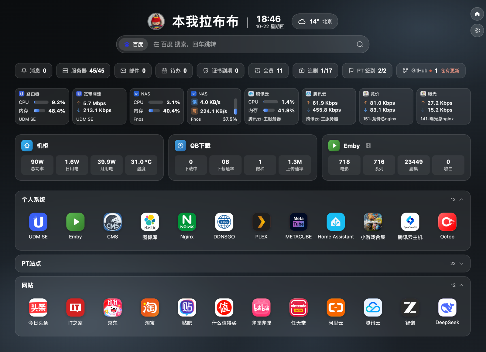
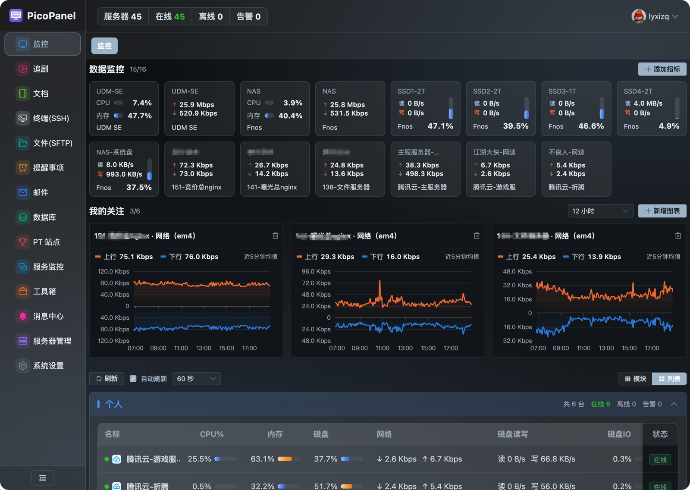
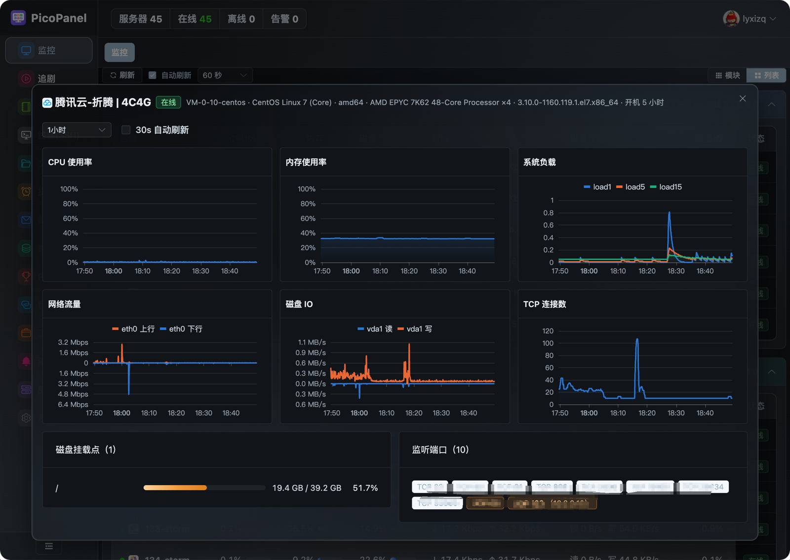
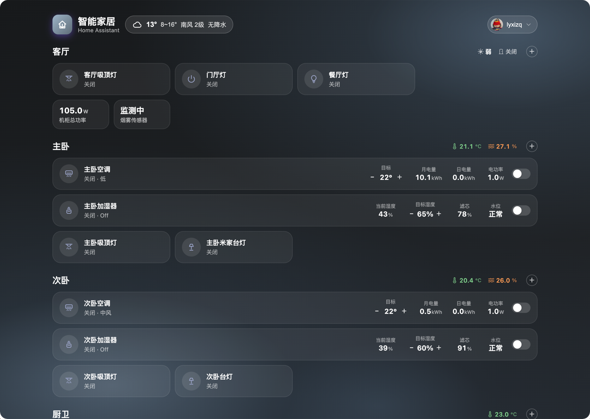

# PicoPanel

<div align="center">


</div>

PicoPanel 是一个 Linux 服务器监控系统：服务端（Go + SQLite，单二进制内嵌 Web 前端）周期采集各服务器的指标、评估告警规则并落库，浏览器登录后查看多台服务器的实时状态与历史曲线；另带 Web SSH 终端、文件管理（SFTP）与文档模块；内置 12 种主题（浅色/暗色/紫罗兰/暗金/青碧/绯夜/冰川/熔岩/苔原/石墨/霓/深海），适配手机浏览。

文档导航：功能全貌见本文件；**日常操作分模块指引见 [OPERATE.md](OPERATE.md)（操作手册）**；部署与升级见 [DEPLOY.md](DEPLOY.md)；功能明细清单见 [FEATURES.md](FEATURES.md)。

三种采集方式按服务器独立选择、可混用：

- **Agent 拉取**（默认）：被监控机运行 lz-agent，开放只读指标端口（`:19100`），服务端周期抓取。适合能装 agent 的机器——agent 零依赖静态编译、不开任何写接口。
- **Agent 上报**：agent 主动把指标 POST 到服务端，本机不开端口。适合 agent 在内网/NAT 后、服务端无法主动访问的场景。
- **node_exporter 拉取**：目标机只跑 Prometheus 生态标准的 node_exporter，服务端拉取其 `/metrics` 并按同口径映射。适合已跑 node_exporter 的机器，无需再装 lz-agent。

> SSH 直连采集已下线（2026-10-04）：新增入口已移除；存量 ssh 机器仍兼容（继续采集、Web 终端可用），不便装 agent 的机器建议用 node_exporter。

## 特性

- **零依赖部署**：服务端单二进制（前端 go:embed 打包），SQLite 单文件存储，无需装数据库
- **采集指标**：CPU、内存/Swap（used 与 Prometheus/node_exporter 标准口径一致：MemTotal − MemAvailable，容器环境按 cgroup 限额修正）、负载（1/5/15）、磁盘（多分区使用率与 IO 使用率，IO 为 iostat %util 口径，仅存最新无历史曲线）、网卡上下行速率、TCP 连接数、监听端口、主机信息与 uptime
- **Web SSH 终端 + 文件管理**：浏览器直开目标机 shell（xterm.js 多标签，vim/htop 等全屏程序可用；网络闪断/反代超时会话自动挂起重连不丢，命令历史+常用命令弹出补全，底部服务器信息栏；关标签二次确认防误触，指纹变更连接失败可一键「重置指纹并重连」）；独立文件管理页（面包屑/多选/右键菜单/拖拽上传/断点续传/大文件分片上传/压缩解压/图片预览/系统关键目录保护），详见「Web 终端与 SFTP 使用」
- **多服务器管理**：分组双视图（模块卡片/行列表）、购买与到期倒计时（临期变色）、监控页自定义数据卡片与「我的关注」折线图，卡片上可直接编辑；服务器规格「几C几G」两处展示——监控卡片运行时长旁（取代原 load 数值）与服务器详情弹层名称后（C=CPU 核心数，G=内存 GB 取整有小数+1；数据缺失只拼已有部分）
- **阈值告警**：指标 + 操作符 + 阈值 + 持续时长，全局或单机规则；离线检测；触发/恢复全程留痕，配合 WxPusher 微信通知、通用 Webhook（自定义 JSON 模板，适配钉钉/飞书/Slack 机器人）或浏览器 Web Push 推送，同时记入站内消息中心；**通知聚合**——短时间（静默 60 秒或窗口满 10 分钟）内多台设备同时告警/恢复合并成一条通知（站内与推送同口径，逐台列出服务器与详情），防服务器成批离线时手机被推送刷屏，代价是单条独立告警的推送延迟约 1 分钟
- **历史曲线**：单机详情页 5 分钟~30 天，自动降采样；点击图表放大可自选时段；网络流量为上下镜像面积图
- **HTTPS 证书监控**：域名清单每小时 TLS 拨询取证书，到期前 15 天顶栏提醒，可配每日到期推送并生成站内提醒消息
- **待办事项**：参考微软 To Do——左侧列表导航（我的一天/重要/计划内/已完成 + 分组彩色图标与未分组收纳）、快速添加与完整表单、重要星标、详情侧栏；**子任务最多 5 级**（独立待办，删除父级整树进回收站，恢复整链联动——后代与在回收站的上级一并恢复，上级链被彻底删除处断开、断点以下升顶级）；重复规则（每天/每周/每月/每年/自定义周期，月末自动收敛）完成后自动生成下一条，已完成可恢复（撤回生成的下一条）；删除进回收站可恢复/彻底删除/清空；三段到期提醒（前 1 小时/到期时/超期一天，可按事项关闭「是否提醒」），站内消息必达并按开关分发推送渠道；未完成事项消息红字展示
- **站内消息中心**：独立菜单页（侧栏菜单项/顶栏下拉/主页统计卡均直达，未读角标、类型筛选、已读管理；页内「消息 | 告警」两 tab，告警规则与历史在告警 tab）聚合告警触发/恢复、证书到期、待办事项、巡检报告、登录提醒、会员到期、邮件与追剧消息，站内记录不受推送渠道开关影响（登录提醒与外部推送同口径：账号/时间/来源 IP）
- **消息推送设置**：系统设置「消息推送」页集中配置三渠道，各带总开关——开启后才能配置并推送，关闭后不可配置且不再推送；Web Push 自动生成 VAPID 密钥、一键订阅当前浏览器（需 HTTPS）
- **工具箱**：40+ 纯前端小工具（网址/编码/实用三类，本地计算不落服务端）+ TCP/UDP 连通检测（服务端发起探测，TCP 实测握手与耗时，按 IP 限流防滥用）
- **服务集成与首页天气**：Homepage widget 同口径接入 Home Assistant / qBittorrent / Emby（服务端代理轮询 + 缓存，规避 CORS 与令牌暴露；凭据加密存库不回显），主页「服务」玻璃卡片四格统计——qB 下载/上传速率与做种数、Emby 媒体库计数与正在播放、HA 实体状态（每 4 个自动分卡）；首页天气胶囊（高德 / Open-Meteo 双服务商——高德中国区更准需免费 Key（注册方法见 FEATURES.md 天气节）、Open-Meteo 免 key 兜底，访客 IP 自动定位或手动城市，3 日预报气泡），均在主页管理抽屉配置
- **更多控制台模块**：**服务监控**（按「服务器 → 监控端口」两级配置 TCP 拨测，每端口业务名+联通状态/延迟/持续时长，整台或全部手动检测）；**邮件**（多账户 IMAP/SMTP，收件本地缓存秒开、发信/附件/未读角标）；**数据库**（MySQL/PostgreSQL/SQLite 只读查询与整库备份，语句白名单防写）；**用量查询 / GitHub 发布监控**（并入服务监控页 tab；用量查询：智谱 Coding Plan 窗口用量 / DeepSeek 余额 / 腾讯 EdgeOne 站点流量带宽请求与防护命中，服务端定时轮询）；**PT 站点**（内置 26 站目录 + 浏览器 Cookie 导入，每天 06:00 抓取上传/下载/分享率/做种/魔力等用户信息，M-Team 走官方 API）；**智能家居**（独立 /ha 全屏页：可控设备开关磁贴 + 温湿度等状态实体 + 房间分区，受限用户专属落点）；**服务状态**（运行指标/日志/连接自检）。功能清单见 FEATURES.md，分模块操作见 [OPERATE.md](OPERATE.md)
- **文档**：分组管理（左栏文档可拖到其他分组头跨组移动、组内拖拽排序）+ 富文本/Markdown 双格式（自动保存、历史版本 10 版、回收站），详见「文档模块使用」
- **体验**：12 种主题可选（浅色/暗色/紫罗兰/暗金/青碧/绯夜/冰川/熔岩/苔原/石墨/霓/深海，记忆选择；深色系全局玻璃拟态，个人主页与智能家居页随主题联动换色）、手机端抽屉导航自适应、多标签页互切不丢状态（本地记忆恢复）
- **Web 登录**：账号密码（bcrypt），首启自动创建 `admin/admin123`；忘记密码可用 `-resetuser` 一键恢复默认；可开启 TOTP 两步验证（Authenticator 扫码），丢失时用 `-resettotp` 清除后密码直接登录

## 界面截图

**个人主页** —— 玻璃拟态卡片、监控模块与服务集成、自定义链接分组



**控制台总览** —— 数据监控磁贴、自定义图表与分组服务器列表



**单机详情** —— 多维历史曲线、磁盘挂载点与监听端口



**智能家居** —— Home Assistant 房间分区、设备磁贴与环境电器



## 架构

```
                          ┌─ Agent 拉取：周期 GET /metrics（可选 X-Server-Token）──► lz-agent (:19100，只读指标端口)
lz-server (手动启动) ──────┼─ node_exporter 拉取：周期 GET /metrics 文本 ──► node_exporter (:9100，标准 Prometheus 格式)
（10s 采集周期）           ├─ SSH 直连（已下线，存量机器兼容）：私钥登录，长连接执行只读命令 ──► 目标机 sshd
                          └─ Agent 上报：◄── lz-agent 周期 POST /api/v1/agent/report（X-Agent-Token，无需开端口）
        ├─ 抓取管理器（拉取/直连 → 组装统一 Report → 写库 → 告警评估；上报在 API 入库走同一条评估路径）
        ├─ 告警引擎（规则缓存/持续判定/离线检测/通知聚合）
        ├─ REST API（Web 会话鉴权；上报端点用 X-Agent-Token）
        └─ SQLite (WAL) + go:embed 前端
```

- Agent 拉取：agent 只开放只读端口，不外发数据、不需要知道服务端地址；内部按 `interval` 持续采样保证差值指标新鲜
- Agent 上报：`agent.yaml` 设 `mode: "push"` + `server_url` + `token`（上报密钥**与服务器一对一**，服务端校验唯一，多台机器分别创建并各用一个密钥）；离线判定基于最后上报时间
- **SSH 直连**（已下线，存量机器兼容）：连接只建一次长期复用（每周期仅开一个 session channel）；CPU/网卡等差值指标由服务端按累计计数器算出；主机指纹 TOFU（首次连接记录，变更即拒绝）
- node_exporter 拉取：服务端按白名单解析映射为同口径指标（无监听端口指标，端口类展示与告警自动跳过）。CPU/网卡/IO 为累计 counter 由服务端算差值，服务端重启后首轮为 0；LVM 逻辑卷（`/dev/mapper/…`）与内核设备名在 /metrics 里无对应关系，此类挂载点 IO 显示 0。可选密钥经 `X-Server-Token` 发送（node_exporter 本体不校验，供前置反代校验用）
- 服务端默认每 10s 采集一轮（拉取/直连共用，`scrape_interval` 可调）；时间戳一律取服务端接收时间
- 标量指标存列、磁盘/网卡列表存 JSON 列，`UNIQUE(server_id, ts)` 幂等写入；近 7 天存 10s 明细、更早自动降采样为 5 分钟均值桶，保留清理每小时执行
- 数据保留天数在 Web「系统设置」页运行期修改（默认 90 天），不在配置文件里

## 快速开始

### 1. 构建

要求：Go 1.26+、Node 18+（仅构建期需要，运行时无 Node 依赖）。

```bash
make server    # 构建前端 + 服务端 → bin/lz-server
make agent     # 本机 agent（macOS 上 /proc 不可用，仅供调试）
make release   # Linux 交叉编译 → release/deploy/{server,agent-amd64,agent-arm64}/
```

### 2. 启动服务端

推荐用启停脚本后台运行（见下方「部署」章节）；临时调试也可直接前台运行：

```bash
./bin/lz-server                    # 或 -config server.yaml（参考 deploy/server.example.yaml）
```

首次启动自动创建管理员 `admin / admin123`（日志有提示），**登录后请立即在右上角「个人信息」里修改用户名与密码**。

### 3. 添加被监控服务器

1. 浏览器打开 `http://<server>:8080`，登录
2. 「服务器管理」→ 新建服务器，三选一（SSH 直连已下线不再提供新增，存量机器兼容）：
   - **Agent 拉取**：填写名称、agent 所在机器的地址（如 `192.168.1.5:19100`，缺省端口自动补 `:19100`）、可选访问密钥（需与 agent.yaml 中 token 一致，多台可共用同一密钥）；再到被监控机部署 agent（下节）
   - **Agent 上报**：填写名称和上报密钥（可点「生成」按钮，也可留空由服务端生成；上报密钥与服务器一对一）；到被监控机部署 agent，`agent.yaml` 写 `mode: "push"`、`server_url: "http://<服务端IP>:8080"`、`token: <上报密钥>`
   - ~~**SSH 直连**~~（已下线，不再提供新增；存量 ssh 机器继续采集、Web 终端可用）
   - **node_exporter**：填写名称、目标机 node_exporter 地址（如 `192.168.1.5:10200`，缺省端口自动补 `:10200`；exporter 跑在标准 `:9100` 时地址写全即可）。指标与本系统 agent 同口径（无监听端口指标）
3. （可选）**Web 终端 / 文件管理**：除「Agent 上报」外的机器自动取配置地址（agent/node 模式取采集地址 host 拼 `:22`）出现在「终端(SSH)」「文件(SFTP)」两页；也可在「编辑服务器」补配终端专用地址与登录凭据——监控走 agent、终端走 SSH 两不误，未配齐凭据时页面会弹框补输
4. （可选）**配置告警**：「告警」页的「告警规则」tab 新建规则——选指标（CPU/内存/磁盘/网卡/负载/TCP 连接数/端口监听）、阈值、持续分钟数（0 = 立即）、作用范围（全局或单机）。磁盘/网卡可指定具体挂载点/网卡，留空表示取最大值（"任一盘满了"语义）；端口监听规则写 `tcp/443`、`udp/53`（纯数字默认 tcp），可选「未监听时告警」（服务端口意外关闭）或「出现监听时告警」（不该开的端口被打开），需要 agent ≥ v0.3（旧 agent 自动跳过不误报）。触发与恢复在「告警历史」tab 查看；通知渠道在「系统设置 → 消息推送」tab 配置——WxPusher 微信推送、通用 Webhook（自定义 JSON 模板，占位符 {{title}}/{{message}}）或浏览器 Web Push，三渠道并存、各带总开关（开启后才能配置并推送）与告警/证书提醒/事项提醒独立开关。「系统设置」页支持一键巡检：汇总在线/告警中/证书临期/资源 TOP，可手动推送或每日定时推送（走已开启的渠道）

## Web 终端与 SFTP 使用

左侧菜单「终端(SSH)」与「文件(SFTP)」两个独立页面：终端页是分组服务器列表 + 多 tab shell；文件页是分组服务器列表 + 宝塔风格文件区（SFTP）。两页左栏的服务器列表均为**分组手风琴**（每组独立点缀色，点击组头折叠/展开，默认只展开第一组）。**除「Agent 上报」外的所有服务器都会出现在列表里**——地址自动取自服务器配置（优先终端专用地址；agent/node 模式取采集地址的 host 拼 `:22`；IPv6 需写 `[::1]:22` 形式），无需逐台补配。

### 连接凭据（终端与文件管理同一套逻辑）

- **配好用户名 + 密码（或私钥）**：点击直接连
- **只配了用户名**：弹密码框，可选「保存密码」——保存后下次直连，可在「编辑服务器」里清除；不保存则密码只存服务端进程内存（重启后重输）
- **都没配**：弹用户名 + 密码框；用户名总会保存到服务器配置，下次只需输密码
- 密码输错：终端 tab 遮罩点「输入密码重连」、文件页点「凭据」按钮重开输入框
- **主机指纹（TOFU）**：首次连接成功自动记录目标机指纹，之后指纹变更会拒绝连接（防中间人）；目标机重装后可重置指纹再连：终端连接失败遮罩的「重置指纹并重连」一键完成（376），或在「编辑服务器」勾选「重置指纹」
- 服务器配置里的 SSH 信息变更或删除服务器后，已有 SFTP 连接立即失效重建

### 终端

- 左栏/下拉按分组展示服务器；点击开一个终端 tab，可同时开多台；**切换 tab 不断会话**（连接保活），关闭 tab 才断开
- 完整的交互式 shell：`vim` / `htop` / `top` 等全屏程序正常使用，窗口缩放自适应
- **命令补全弹出层**：输入时在光标下方弹候选列表（本地历史按服务器记忆 + 内置常用命令），↑↓ 选择、→/Tab/点击采纳、Esc 关闭
- **底部服务器信息栏**：CPU/内存/磁盘/Swap 迷你进度条、负载、网络上下行、磁盘读写、运行时长（30 秒轮询，与终端连接无关）
- **会话挂起/重连**：WebSocket 意外断开（反代超时、切后台被杀、网络闪断）时 SSH 会话在服务端挂起 10 分钟——SSH 与 PTY 照跑、输出缓冲重放，前端退避自动重连续接；只有刷新页面或挂起超时才真正回收
- 会话安全：WebSocket 每 30 秒复验登录会话——**登出或修改密码会踢掉全部终端**；无流量 30 分钟自动断开

### 文件管理（独立页面，SFTP）

左栏选服务器后进入宝塔风格文件区（SFTP 连接按服务器池化在服务端，文件页无需开终端）：

- **导航**：面包屑点击任意层级跳转 + 「上级 / 刷新」按钮 + 当前目录关键字过滤
- **列表**：大字号 + 文件类型图标（目录/链接/设备/图片/视频/音频/压缩包/脚本/文档各自配色）；**类型**与**所有者**列均可排序；操作列为图标按钮
- **上传**：按钮选多个文件串行流式上传，或**从本地直接拖拽进文件区**；当前目录已有**同名文件时先确认是否覆盖**（取消则跳过该文件继续传其余）。远端先写入 `<name>.lzpart` 临时文件、传完原子改名为正式名；右下角上传面板显示**实时进度（已传/总量/速度）**
- **下载**：文件行按钮/右键菜单/**双击文件（确认后开始）**，走**浏览器原生下载**——文件直接落浏览器下载目录，暂停/恢复/进度都在浏览器下载页管理
- **断点续传**：上传取消或失败后远端保留 `.lzpart` 残片，任务留在上传面板点「续传」从断点接着传；「清除记录」会连带删掉远端残片
- **大文件与压缩包**：单文件上传上限 5G（8MB 分片顺序传，绕开反代请求体限制）；双击压缩包解压（支持 tar/tar.gz/tgz/zip，后台任务带进度与取消，解压前同名冲突预检；Windows 中文 zip 文件名自动修正）；选中项打包下载或多选打包为 tar.gz
- **在线编辑与预览**：Monaco 编辑器（语法自动识别、格式化、Ctrl+S 保存，二进制拒编辑、.txt 强制按文本打开）；图片文件双击弹层预览；文件内容搜索（正则/递归/后缀过滤）与按名称递归找文件
- **新建文件 / 新建目录**（可多级）、**重命名**（同名目标覆盖，类 `mv`）
- **删除**：文件直接删；目录先递归统计再确认（「含 N 个文件、M 个子目录」）；**系统关键目录保护**——`/`、`/etc`、`/usr`、`/var`、`/boot` 等目录本身禁止删除，系统目录内的条目删除前弹强提示确认（`/home`、`/opt`、`/srv`、`/tmp` 为用户自管区不拦）；支持多选批量删除；右键菜单同样可下载/重命名/删除
- **右键即选中**：右键未选中的行自动单选该行再弹菜单（已在多选内则保留整批，批量右键操作不受影响）
- **属性弹窗**：目录默认不统计，点「计算」才开始后台递归统计个数与占用（实时回传、可取消，不受 HTTP 超时限制；无权限子目录跳过并标注「未计入」），超大目录不再统计失败
- 公网经反代传大文件（数百 MB 以上）需放宽各层超时（见 DEPLOY.md「公网接入」），否则建议改用 scp/sftp 客户端直连目标机

经公网反代使用时必须配置 TLS 并透传 WebSocket（配置见 DEPLOY.md「公网接入」）；终端里输入的一切（包括 sudo 密码）都经过这条链路。

### 凭据与密钥的存储口径（打码）

- `/servers` 接口**不回显** SSH 密码与密钥明文，只返回「是否已配置」布尔；编辑弹窗里密码/密钥输入框**留空 = 不修改**，勾选「清除」才删除（上报模式的密钥不可清除，只能「生成新密钥」换新）
- 上报（push）服务器创建时，密钥**仅此一次展示**（复制保存到 agent.yaml），此后任何页面不再显示明文
- 终端/文件页输入且未勾保存的密码只存服务端进程内存，服务端重启后需重输

## 部署

> 完整部署文档（发布产物说明、服务端与 agent 步骤、server.yaml / agent.yaml 全字段表、启停脚本五命令、node_exporter 使用、公网 Nginx/CDN 接入、端口与防火墙清单、升级回滚汇总）见 **[DEPLOY.md](DEPLOY.md)**，本章只留最短路径。

`make release` 产出 `release/deploy/` 下三个部署目录（gzip 压缩二进制 + 配置模板 + 启停脚本，**不打 tar 包**），服务端与 agent 分目录部署：

```
/home/lz-monitor/
├── server/    # lz-server.gz + server.yaml + lz-server.sh（服务端机）
└── agent/     # lz-agent.gz  + agent.yaml  + lz-agent.sh（被监控机，按架构选 agent-amd64 / agent-arm64）
```

```bash
# 开发机：上传
rsync -a release/deploy/server/ user@server:/home/lz-monitor/server/
rsync -a release/deploy/agent-amd64/ user@target:/home/lz-monitor/agent/

# 服务端机：
cd /home/lz-monitor/server
./lz-server.sh start     # 后台启动；数据库 lz-monitor.db 与 lz-server.log 都在本目录

# 被监控机：先按采集模式改好 agent.yaml（pull / push 两出口示例与全字段说明见 DEPLOY.md）并 chmod 600
cd /home/lz-monitor/agent && ./lz-agent.sh start
```

- **请一律通过启停脚本启动，不要直接运行二进制**：部分虚拟化环境（OpenVZ/LXC 等）Go 运行时会把 CPU 配额推导为 0，直接运行启动即崩；脚本自动回退 `GOMAXPROCS=逻辑核数` 规避
- 忘记密码：`./lz-server.sh restart -resetuser`（重置为 admin/admin123 后继续正常启动）；两步验证丢失：`restart -resettotp`（清除 TOTP 后密码直接登录）
- **升级**：运行中的进程持有二进制 inode，scp/rsync 直接覆盖会报 `Text file busy`——上传新的 `.gz` 后执行 `./lz-server.sh upgrade`（解压 → 替换 → 重启，旧版留 `.old`，回滚 `mv` 回去再 `restart`；agent 同理）
- 旧库首次用新版启动会自动迁移（幂等，大库迁移期间服务中断约 1~3 分钟，日志可见进度）

## 安全说明

- **改默认密码**：首启创建的 `admin/admin123` 必须立即修改；登录连续失败 5 次将锁定来源 IP 10 分钟（防在线暴力破解）
- **敏感字段加密存储**：servers 表中的 IP 地址（agent_addr/ssh_addr）、SSH 用户名、SSH 密码、token 均以 AES-256-GCM 加密落库（密文带 `enc:v1:` 前缀，旧明文数据启动时自动迁移加密）。密钥为 32 字节随机数，**首次启动服务端时自动生成**，写入固定路径 **`/etc/lm.idc`**（base64 文本，权限 0600，文件不存在则自动创建；路径写死在代码里，不进配置文件）。注意：**该密钥文件必须随数据库一起备份**——丢失后已加密的密码/IP 无法恢复（表现为服务器连不上，重新填写凭据即可）；它防的是数据库文件单独泄露（备份被拷、db 被拖走）时读不出明文，拿到服务器 root 者仍可读取密钥，这与所有本机加密方案的边界一致
- **文档模块的取舍**：文档内容（富文本 HTML / Markdown 预览）不做 HTML 消毒——本系统为单管理员自写自看，无多用户互投攻击面；请勿把不可信来源的 HTML 粘贴进文档。富文本与 Markdown 编辑器的图片均以 base64 内嵌存储（单图限 1MB、单篇上限 20MB），大量截图请外链；Markdown 编辑器的代码高亮 / Mermaid / 公式等按需资源已本地化打进单二进制，内网离线可用。多窗口同开一篇文档有**乐观锁**——保存时携带基准版本校验，其他窗口先保存过则拒绝（409），弹框选择「覆盖远端」或「载入最新版」
- **网络边界**：服务端为明文 HTTP，建议只部署在内网/可信网络；需经公网访问时请在前面加 Nginx/Caddy 反向代理并配置 TLS（反代与 CDN 接入配置见 DEPLOY.md「公网接入」；agent 的 `server_url` 同步改为 https）。可选 `web_allow` 白名单限制访问来源（IP/CIDR/域名）
- **agent 指标端口**：agent 在被监控机上开放只读端口（默认 `:19100`），任何能访问该端口的人都可读取指标——与 node_exporter 相同的模型，请用防火墙限制来源，或在 agent.yaml 配置 `token`（服务端创建/编辑服务器时填写相同值），抓取请求将校验 `X-Server-Token`。agent.yaml 建议 `chmod 600`
- **agent 无入侵面**：agent 仅暴露 `GET /metrics` 一个只读精确路由（零参数解析、无文件读取、无命令执行，CGO_ENABLED=0 静态编译），不接收任何写操作；上报模式不监听任何端口、纯出站。未配 token 时最坏情况也只是指标（主机名、流量等侦察级信息）可被读取，结构上不存在权限提升；配 token 后读取返回 401。资源占用：CPU <0.1% 单核、常驻内存 10~15MB，可常年运行
- **SSH 凭据的权限权衡**：SSH 凭据等于目标机完整 shell——监控服务端失守即波及所有 SSH 接入的机器，与 agent 模式（只读指标）有本质区别。SSH 直连采集虽已下线，「编辑服务器」里的 Web 终端/SFTP SSH 配置（以及存量 ssh 采集机器）仍凭 SSH 登录目标机。建议：为目标机建专用低权限账号；认证推荐私钥（密码认证已支持，密码加密存库），私钥文件 `chmod 600`
- **SSH 主机指纹（TOFU）**：首次成功连接自动记录目标机指纹，之后指纹变更将拒绝连接（防中间人）；目标机重装后可重置指纹：终端失败遮罩「重置指纹并重连」一键完成，或在「编辑服务器」勾选
- **Web 终端 / 文件管理的额外注意**：终端会话使用与 SSH 采集相同的凭据（勾选保存的密码加密存库；未勾保存的只存服务端进程内存，重启即失）；接口不回显密码/密钥明文（只回「是否已配置」）；SFTP 删除为**递归删除**（目录删除前有内容量确认框，超过 20 万条目会拒绝并提示分批处理），重命名为覆盖语义——请谨慎操作
- 内置防护：登录失败限流、登录恒时比较（无法用耗时差异枚举用户名）、agent 上报密钥恒时比较、多窗口文档编辑乐观锁（409 冲突）、可选 Web 访问白名单、全参数化 SQL、HTTP 请求超时、抓取响应限 1MB、时间戳取服务端时间（无法伪造历史数据）、静态资源走 embed FS（无路径穿越面）、全站安全响应头（nosniff / SAMEORIGIN / Referrer-Policy）、文档附件 MIME 白名单内联（其余强制下载）。HTTPS 部署可配 `cookie_secure`；边缘代理取真实 IP 的 `real_ip_header` 必须配合 `trusted_proxies` 网段才生效（未配网段一律不采信，防直连伪造），详见 DEPLOY.md 3.3
- 已知取舍：能同时读到库文件**和**密钥文件（`/etc/lm.idc`）已是更高一级的失守（如服务端 root 被拿下）；如需更强隔离建议库文件所在盘加密

## Homepage 集成（只读接口）

[Homepage](https://gethomepage.dev) 等常驻面板无法维持 Web 登录会话（7 天过期），为此提供 `snapshot_token`（空 = 不开通，server.yaml 配置，全字段说明见 DEPLOY.md）保护的两个只读接口：

1. 生成令牌并写入 server.yaml（重启生效）：`openssl rand -hex 32` → `snapshot_token: "<令牌>"`
2. 验证（令牌放 `X-Snapshot-Token` 请求头，不进 URL——查询参数会落访问/反代日志）：
   `curl -H 'X-Snapshot-Token: <令牌>' 'http://<服务端>:8080/api/v1/snapshot?server=<名称或ID>'`
   `curl -H 'X-Snapshot-Token: <令牌>' 'http://<服务端>:8080/api/v1/query?query=lz_cpu{server="<名称或ID>"}'`

**快照接口** `/api/v1/snapshot?server=<名称或ID>` 一次返回一台机器的全部指标，适合单机小部件（Homepage `customapi`）。返回的扁平字段：`cpu`/`mem`/`swap`（使用率 %）、`mem_used`/`mem_total`（字节）、`mem_h`（"2.0 GB / 4.0 GB"）、`load1/5/15`、`disk`（各挂载点最大使用率）、`io`（最大 IO 使用率）、`net_rx`/`net_tx`（合计 B/s，按服务器的「展示网口」配置）、`net_rx_h`/`net_tx_h`（"1.2 Mbps" 预格式化）、`tcp_est`、`uptime`/`uptime_h`、`online`、`firing`、`ts`。最小可用示例：

```yaml
- 服务器监控:
    - web-01:
        widget:
            type: customapi
            url: http://10.2.0.1:8080/api/v1/snapshot?server=web-01
            headers:
                X-Snapshot-Token: <令牌>
            refreshInterval: 30000
            mappings:
                - { field: cpu, label: CPU, format: percent }
                - { field: mem_h, label: 内存 }
                - { field: net_rx_h, label: 下行 }
                - { field: net_tx_h, label: 上行 }
```

`server` 参数填服务器管理页显示的**名称**（也可填详情页 URL 里的数字 ID）；`refreshInterval` 单位毫秒，建议不低于服务端采集周期。

**即时查询接口** `/api/v1/query` 模仿 Prometheus instant query，适合同一条目混排多台服务器或只取零星小值（Homepage 现成的 `prometheusmetric` 小部件，每行指标一次查询）。查询语法：`lz_<指标>{server="<名称或ID>",token="<令牌>",mount="<挂载点>",device="<网卡>"}`。指标一览：

| 查询 | 含义 | 可选标签 |
|---|---|---|
| `lz_cpu` / `lz_mem` / `lz_swap` | CPU / 内存 / Swap 使用率 % | |
| `lz_mem_used` / `lz_mem_total` | 内存用量字节 | |
| `lz_load1` / `lz_load5` / `lz_load15` | 负载 | |
| `lz_disk` | 磁盘使用率 % | `mount`（缺省取最大值） |
| `lz_io` | 磁盘 IO 使用率 % | `mount`（缺省取最大值） |
| `lz_net_rx` / `lz_net_tx` | 网卡速率 B/s | `device`（缺省按服务器的网口配置过滤） |
| `lz_tcp_est` | TCP 连接数 | |
| `lz_uptime` | 运行秒数 | |
| `lz_online` / `lz_firing` | 在线（1/0）/ 告警中条数 | |

注意：`prometheusmetric` 小部件的 url 无法自定义请求头，令牌只能写在查询串的 `token` 标签里——**该令牌会随 URL 落访问/反代日志**，属已知取舍：建议 `snapshot_token` 专用且不与其他凭据复用；curl/脚本调用优先用 `X-Snapshot-Token` 请求头（不落日志）。令牌可读取全部服务器的只读指标，泄露面与 Web 账号相当，请勿提交到公开仓库；接口仅返回最新一份快照，不暴露历史数据。

## 开发

```bash
make test                        # go vet + 全部单测
cd web && npm run dev            # 前端开发模式（代理 /api → :8080）
./bin/lz-agent -listen :19100   # 本机联调（macOS 上 /proc 不可见属预期，指标为 0）
```

目录结构：`cmd/` 两个入口；`internal/proto` 快照契约（含 /proc 行级解析，agent 与存量 SSH 采集共用）；`internal/agent` 采集与指标端口（collect/ 各采集器含 fixture 单测）；`internal/server` 下 store（SQLite 两段式存储：近 7 天 10s 明细 + 更早 5 分钟均值桶）、scrape（抓取管理器）、engine（告警引擎）、api（REST + 静态资源）、ui（embed）。前端 Vue3 + Element Plus + ECharts 在 `web/`。

## 开源协议

本项目基于 [MIT License](LICENSE) 开源。

